# ☁️ TP3 — CI/CD avec GitHub Actions et Render

<div align="center">

# 🚀 Pipeline CI/CD automatisé

**Intégration continue (CI) et déploiement continu (CD) d'une application Node.js, Express et TypeScript**


**Objectif :** Mettre en place un pipeline CI/CD automatisé permettant de vérifier le code, d'exécuter les tests et de déployer l'application sur Render uniquement lorsque les vérifications requises réussissent.

🌐 **Application en production :** [https://tp3-ci-cd.onrender.com](https://tp3-ci-cd.onrender.com)

📄 **Rapport du TP3 :** [Télécharger le rapport PDF](./TP3_partie1.pdf)

</div>

---

## 📑 Sommaire

- [1. Présentation du projet](#-1-présentation-du-projet)
- [2. Préparation de l'environnement local](#-2-préparation-de-lenvironnement-local)
- [3. Premier déploiement sur Render](#-3-premier-déploiement-sur-render)
- [4. Mise en place de l'intégration continue](#-4-mise-en-place-de-lintégration-continue)
- [5. Sécurisation et automatisation du déploiement](#-5-sécurisation-et-automatisation-du-déploiement)
- [6. Gestion d'un échec de test](#-6-gestion-dun-échec-de-test)
- [7. Environnements de prévisualisation](#-7-environnements-de-prévisualisation)
- [8. Résultat final](#-8-résultat-final)
- [9. Technologies utilisées](#-9-technologies-utilisées)

---

## 🎯 1. Présentation du projet

Ce TP consiste à mettre en œuvre une chaîne d'intégration et de déploiement continus pour une application web développée avec Node.js, Express et TypeScript.

Le pipeline automatise les principales étapes du cycle de développement :

- Installation des dépendances.
- Vérification des types TypeScript.
- Exécution des tests automatisés.
- Compilation de l'application.
- Vérification du code avant la fusion d'une Pull Request.
- Déploiement automatique sur Render après validation.
- Création d'environnements de prévisualisation pour les Pull Requests.

### 🔄 Architecture du pipeline

```text
Développeur
    |
    v
Git Push / Pull Request
    |
    v
GitHub Actions (CI)
    |
    +--> Installation des dépendances
    |
    +--> Vérification TypeScript
    |
    +--> Tests automatisés
    |
    +--> Build
    |
    v
Validation des contrôles
    |
    +--> Échec : fusion bloquée
    |
    +--> Succès : fusion autorisée
                    |
                    v
             Déploiement Render
                    |
                    v
             Application en ligne
```

---

## 💻 2. Préparation de l'environnement local

### 2.1. Configuration de l'environnement

Installation des dépendances du projet avec `npm ci` et préparation de l'environnement de développement local.

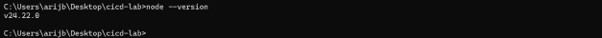
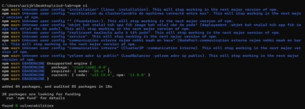
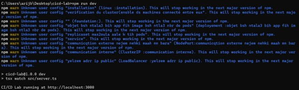


### 2.2. Exécution de l'application locale

Lancement de l'application et vérification de son fonctionnement sur le port 3000.

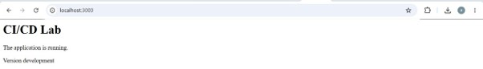

### 2.3. Configuration du script de vérification

Ajout du script `verify` dans le fichier `package.json` afin de regrouper les contrôles nécessaires avant l'intégration du code.

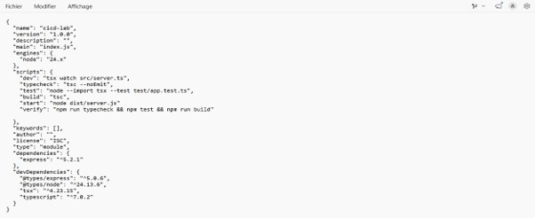

### 2.4. Vérification du projet

Exécution de la commande suivante pour vérifier le projet localement :

```bash
npm run verify
```

Cette commande permet de lancer les vérifications configurées dans le projet.

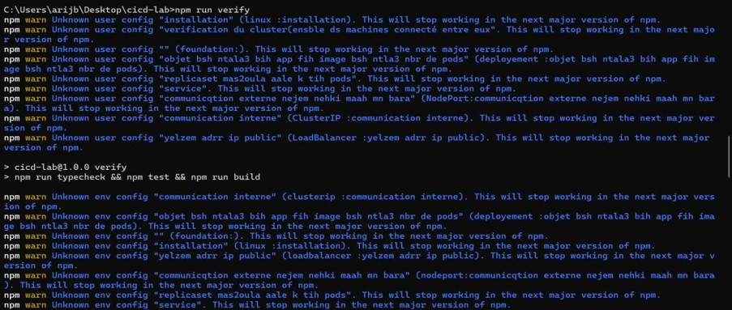

### 2.5. Premier envoi du code sur GitHub

Initialisation du dépôt Git et envoi du code source sur la branche principale.

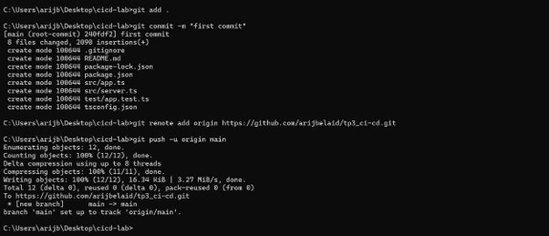

---

## 🌐 3. Premier déploiement sur Render

### 3.1. Création du service Render

Création d'un service Web sur Render et connexion au dépôt GitHub contenant l'application.

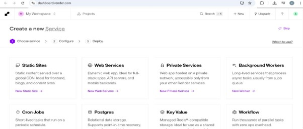

### 3.2. Vérification du premier déploiement

Contrôle des journaux de déploiement et vérification de l'état du service.

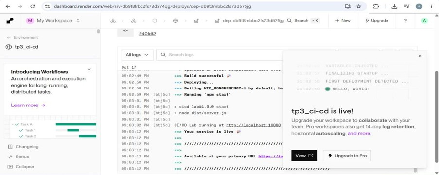

### 3.3. Accès à l'application en production

Une fois le déploiement terminé, l'application est accessible à l'adresse suivante :

**URL :** [https://tp3-ci-cd.onrender.com](https://tp3-ci-cd.onrender.com)

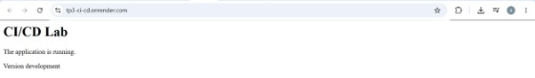

---

## ⚙️ 4. Mise en place de l'intégration continue

### 4.1. Configuration de GitHub Actions

Création du workflow `.github/workflows/ci.yml` pour automatiser les vérifications du projet lors des événements Git configurés.


### 4.2. Création d'une Pull Request

Ouverture d'une Pull Request afin de vérifier automatiquement les modifications proposées avant leur fusion dans la branche principale.

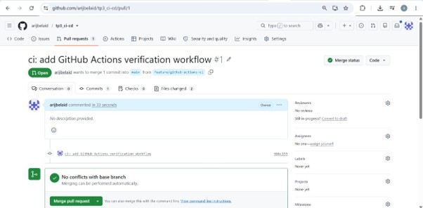

### 4.3. Validation et fusion de la Pull Request

Après la réussite des contrôles automatisés, la Pull Request peut être fusionnée conformément aux règles du dépôt.

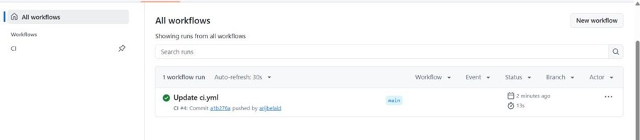

---

## 🛡️ 5. Sécurisation et automatisation du déploiement

### 5.1. Configuration du déploiement automatique

Configuration de Render pour déclencher le déploiement après la réussite des contrôles CI requis.

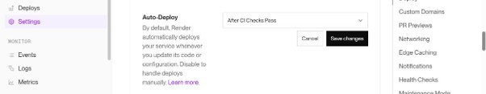

### 5.2. Protection de la branche principale

Mise en place d'un *Ruleset* GitHub afin d'imposer la réussite du contrôle `Verify` avant la fusion des Pull Requests.

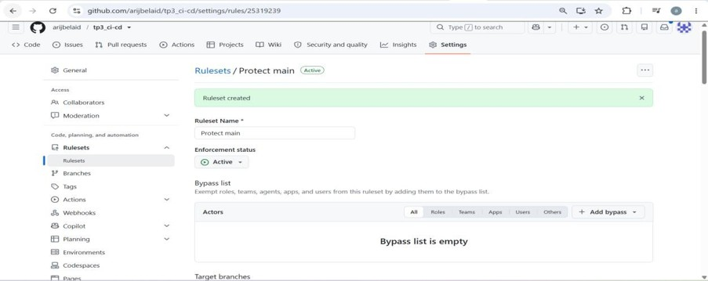

### 5.3. Modification de l'application

Modification du fichier `src/app.ts` pour ajouter du contenu et tester le fonctionnement du pipeline lors d'une nouvelle évolution du code.


### 5.4. Envoi de la mise à jour

Création d'une nouvelle branche et envoi des modifications sur GitHub avant l'ouverture d'une Pull Request.

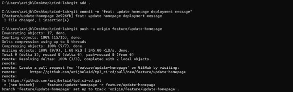

---

## 🚦 6. Gestion d'un échec de test

### 6.1. Détection de l'échec par la CI

Introduction d'une erreur afin de vérifier que le pipeline détecte un test en échec et empêche la fusion lorsque les règles de protection l'exigent.

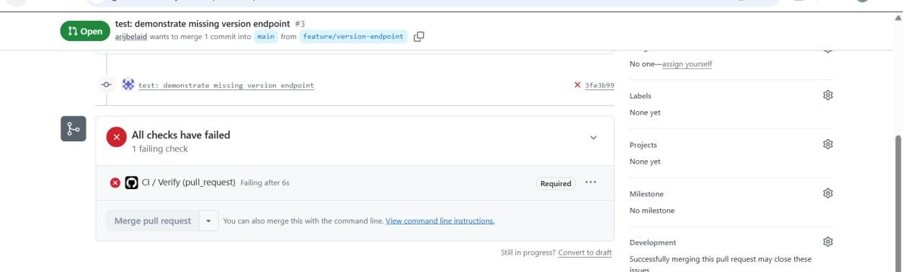

### 6.2. Correction du code source

Correction de l'application en ajoutant la route `/api/version` attendue par le test.

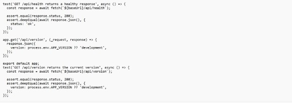

### 6.3. Nouvelle validation du pipeline

Après la correction, les vérifications sont relancées. La Pull Request peut être fusionnée lorsque les contrôles requis réussissent.


### 6.4. Vérification de l'API en production

Vérification du nouvel endpoint `/api/version` après le déploiement de la correction.

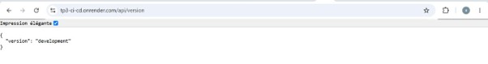

---

## 🔍 7. Environnements de prévisualisation

### 7.1. Activation des environnements Preview

Configuration des environnements de prévisualisation Render pour permettre de tester les modifications d'une Pull Request sans modifier directement la version de production.

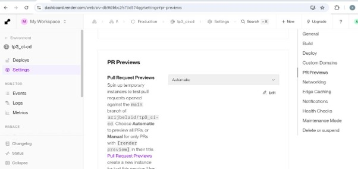

### 7.2. Vérification de l'URL de prévisualisation

Accès à l'environnement temporaire pour vérifier les changements proposés avant leur fusion.

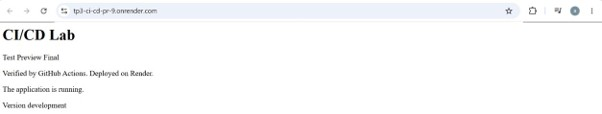

### 7.3. Vérification de la version de production

Comparaison avec la version de production, qui reste indépendante des modifications non encore fusionnées.

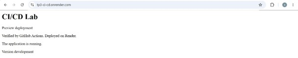

---

## ✅ 8. Résultat final

Ce TP a permis de mettre en place un pipeline CI/CD comprenant :

- L'automatisation des vérifications du code avec GitHub Actions.
- La validation des Pull Requests avant leur fusion.
- La protection de la branche principale.
- Le déploiement sur Render après les contrôles requis.
- La détection et la correction d'un échec de test.
- Les environnements de prévisualisation pour tester les modifications.

Le pipeline améliore la fiabilité des livraisons, réduit les interventions manuelles et facilite la maintenance de l'application.

---

## 🧰 9. Technologies utilisées

| Technologie | Rôle |
|---|---|
| Node.js | Environnement d'exécution JavaScript |
| Express | Framework de développement de l'API |
| TypeScript | Typage statique du code |
| npm | Gestion des dépendances et des scripts |
| Git | Gestion de versions |
| GitHub | Hébergement du code et gestion des Pull Requests |
| GitHub Actions | Automatisation de la CI |
| Render | Hébergement et déploiement de l'application |

---

<div align="center">

**Réalisé par [Arij Belaid](https://github.com/arijbelaid)**

*TP3 — DevOps : Intégration continue et déploiement continu*

</div>
