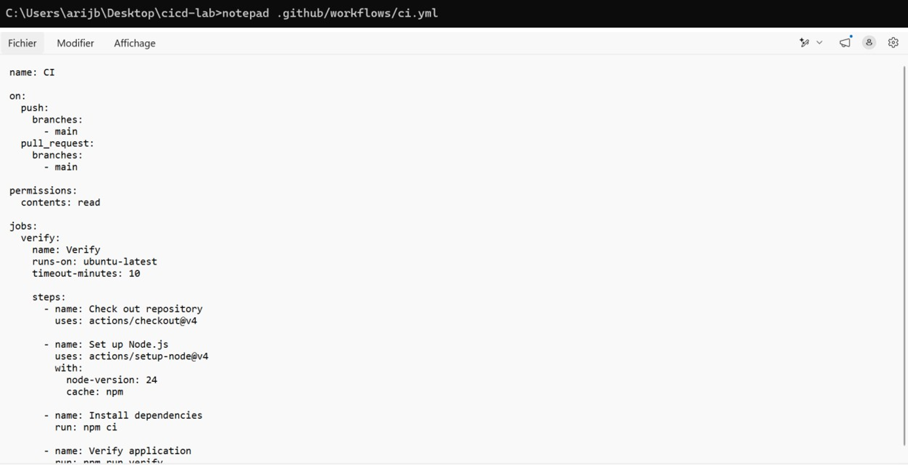
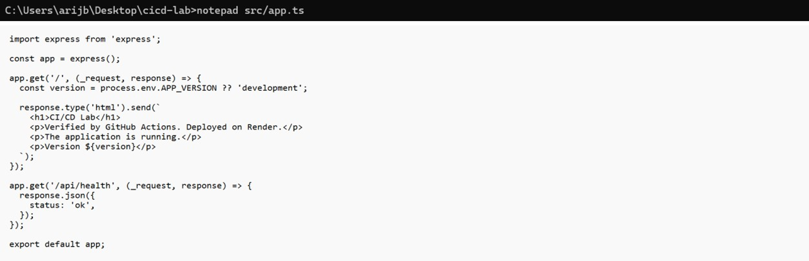
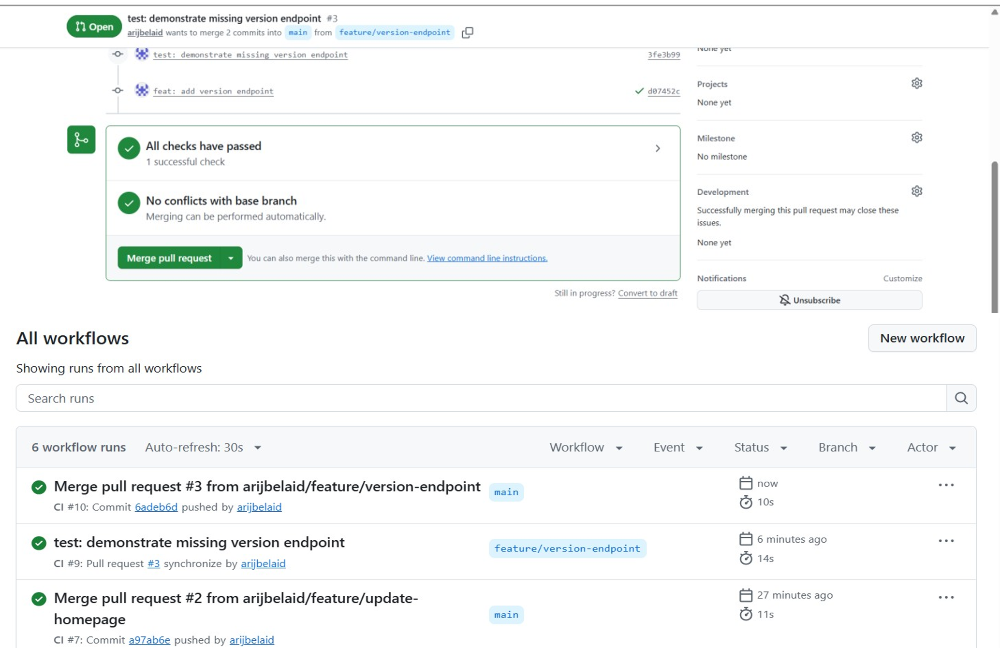

  <h1>☁️ TP3 : CI/CD avec GitHub Actions et Render</h1>
  
<strong>Pipeline d'Intégration Continue (CI) et de Déploiement Continu (CD)</strong>

  
  
  
  
  

 

> **Objectif :** Mettre en place une usine logicielle (CI/CD) complète pour une application Node.js/Express/TypeScript. Chaque `git push` déclenche des tests automatisés, et le déploiement sur Render n'a lieu que si les tests passent. L'environnement inclut également des déploiements de prévisualisation (Previews).

   
  🔗 <strong>Application en production :</strong> <a href="https://tp3-ci-cd.onrender.com">https://tp3-ci-cd.onrender.com</a>
    
  📄 <strong><a href="./TP3.pdf">Télécharger le rapport complet du TP3 (PDF)</a></strong>
    

---

## 🚀 1. Préparation Locale et Premier Déploiement

### Initialisation du projet
Installation des dépendances et lancement de l'application en local.

### Ajout de la commande de vérification
Ajout du script `verify` dans le `package.json` pour lancer les tests, le typecheck et le build.

### Premier Push et Déploiement Render
Envoi du code sur GitHub et création du service Web sur Render.

Le premier déploiement est un succès, l'application est en ligne !

---

## ⚙️ 2. Mise en place de l'Intégration Continue (CI)

### Configuration de GitHub Actions
Création du workflow `.github/workflows/ci.yml` pour automatiser les tests.

### Validation via Pull Request
Création d'une Pull Request pour vérifier que le pipeline fonctionne.

---

## 🛡️ 3. Sécurisation et Automatisation du Déploiement

### Configuration de Render
Le déploiement automatique est configuré pour ne se lancer **qu'après** le succès des tests CI (`After CI Checks Pass`).

### Protection de la branche `main` sur GitHub
Mise en place d'un *Ruleset* exigeant que le check `Verify` passe avant de pouvoir merger.

### Mise à jour de l'application
Modification du code source, push sur une branche et Pull Request.

---

## 🚦 4. Démonstration d'un Échec de Test

Nous avons volontairement introduit une erreur (route `/api/version` manquante) pour prouver que le pipeline bloque le déploiement.

### Échec de la Pull Request
Le check `Verify` échoue (croix rouge) et le bouton "Merge" est bloqué par la règle de protection.

### Correction et Succès
Ajout de la route manquante dans `src/app.ts`, ce qui relance les tests avec succès.

### Vérification de l'API
Test du nouvel endpoint en production.

---

## 🔍 5. Environnements de Prévisualisation (Previews)

Activation des Previews sur Render pour tester les branches avant de les fusionner.

### Comparaison Preview vs Production
L'URL de Preview affiche le nouveau texte ("Test Preview Final"), tandis que la Production garde l'ancien code tant que la PR n'est pas mergée.

**URL de Preview :**

**URL de Production :**

---
*Réalisé par [Arij Belaid](https://github.com/arijbelaid) dans le cadre du cours de DevOps.*
